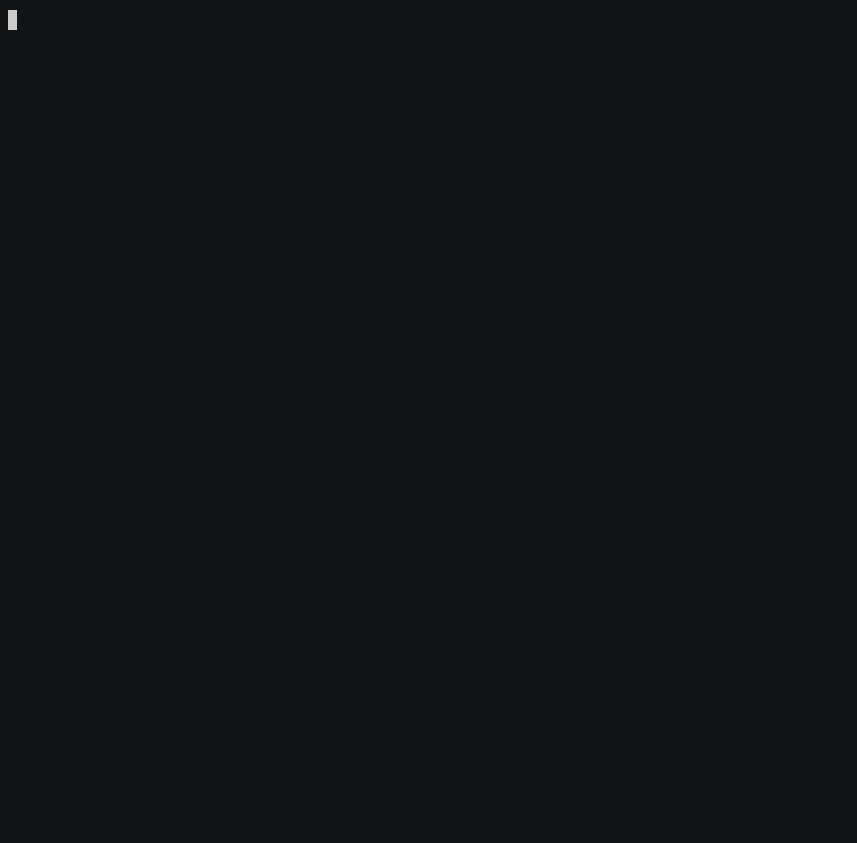

# WhyIsItDown

dig·nc·openssl·curl을 차례로 치기 전에, 어디서 끊겼는지부터 확인한다.

DNS → TCP → TLS → Certificate → HTTP → Redirect

[](https://github.com/wookja-0/whyisitdown/actions/workflows/ci.yml)
[](https://github.com/wookja-0/whyisitdown/releases/latest)
[](https://goreportcard.com/report/github.com/wookja-0/whyisitdown)
[](LICENSE)

[English](README.md) · **한국어**

`whyisitdown`은 URL 하나를 받아 요청이 실제로 거치는 순서대로 스택을 따라 내려가며,
**어느 계층에서 멈췄는지**와 그 원인으로 흔한 것들, 그리고 다음에 실행할 명령을 알려준다.
단일 바이너리이고 데몬도 root 권한도 필요 없다.



## 장애가 났을 때

실패한 계층이 눈에 들어오고, 그 아래에 추정 원인과 다음에 칠 명령이 붙는다.

```
DNS
✓ 10.0.3.18
  21ms

TCP
✗ 10.0.3.18:443
✗ Connection to 10.0.3.18:443 timed out.

  Possible causes
  - a security group, NACL or firewall is dropping the packets
  - the service is not listening on port 443
  - the load balancer has no healthy target
  - asymmetric routing or a missing return route

  Try
    nc -vz 10.0.3.18 443
    curl -v --connect-timeout 5 https://10.0.3.18:443/

────────────────────────────────────

Summary
DNS          PASS  21ms, 1 address
TCP          FAIL  5000ms
TLS          SKIP
Certificate  SKIP
HTTP         SKIP
Redirect     SKIP

Diagnosis
DNS resolution succeeded, but the TCP connection to port 443 timed out.

Likely area
Network / Firewall / Load Balancer
```

> 위 출력은 도구가 실제로 내보내는 그대로다. 번역해 두면 실행했을 때 보이는 화면과
> 달라지므로 영문을 유지한다.

## 설치

모든 릴리스에는 `checksums.txt`가 함께 올라간다. 다운로드를 검증하고 싶으면 사용한다.

### macOS

#### Apple Silicon

```bash
curl -sSL https://github.com/wookja-0/whyisitdown/releases/latest/download/whyisitdown_Darwin_arm64.tar.gz | tar -xzf - whyisitdown
sudo mv whyisitdown /usr/local/bin/
whyisitdown --version
```

#### Intel

```bash
curl -sSL https://github.com/wookja-0/whyisitdown/releases/latest/download/whyisitdown_Darwin_x86_64.tar.gz | tar -xzf - whyisitdown
sudo mv whyisitdown /usr/local/bin/
whyisitdown --version
```

바이너리에 서명이 되어 있지 않다. `curl`로 받으면 문제없지만, 브라우저로 아카이브를 받았다면
`xattr -d com.apple.quarantine whyisitdown`으로 격리 플래그를 지워야 한다.

### Linux

#### x86_64

```bash
curl -sSL https://github.com/wookja-0/whyisitdown/releases/latest/download/whyisitdown_Linux_x86_64.tar.gz | tar -xzf - whyisitdown
sudo mv whyisitdown /usr/local/bin/
whyisitdown --version
```

#### arm64

```bash
curl -sSL https://github.com/wookja-0/whyisitdown/releases/latest/download/whyisitdown_Linux_arm64.tar.gz | tar -xzf - whyisitdown
sudo mv whyisitdown /usr/local/bin/
whyisitdown --version
```

### Windows

PowerShell:

```powershell
Invoke-WebRequest -Uri https://github.com/wookja-0/whyisitdown/releases/latest/download/whyisitdown_Windows_x86_64.zip -OutFile whyisitdown.zip
Expand-Archive -Path whyisitdown.zip -DestinationPath .
.\whyisitdown.exe --version
```

어느 디렉터리에서나 실행하려면 `whyisitdown.exe`를 `PATH`에 있는 경로로 옮긴다.

### Go

```bash
go install github.com/wookja-0/whyisitdown@latest
whyisitdown --version
```

### 소스에서 빌드

```bash
git clone https://github.com/wookja-0/whyisitdown
cd whyisitdown
go build -o whyisitdown .
./whyisitdown --version
```

### Homebrew

준비 중.

## 빠른 시작

```bash
whyisitdown https://example.com
whyisitdown api.example.com --timeout 2s
whyisitdown api.example.com --json
```

## 사용법

```bash
whyisitdown <target> [flags]
```

scheme을 생략하면 `https`, 포트를 생략하면 scheme의 기본 포트를 쓴다. 아래는 전부 유효한 입력이다.

```text
example.com
https://example.com
http://example.com
example.com:8443
https://example.com:8443/api/health
10.0.3.18
https://[2606:4700::1]/
```

| 플래그 | 기본값 | 설명 |
| --- | --- | --- |
| `--timeout` | `5s` | **단계별** 타임아웃. 각 단계가 자기 예산을 따로 쓰므로 느린 계층 하나가 다음 단계를 굶기지 않는다. |
| `--no-color` | 꺼짐 | ANSI 색을 끈다. `NO_COLOR`와 `TERM=dumb`도 따르고, 출력이 터미널이 아니면 스스로 꺼진다. |
| `--json` | 꺼짐 | 터미널용 출력 대신 기계가 읽는 JSON을 출력한다. |
| `--verbose`, `-v` | 꺼짐 | cipher suite, SNI, SAN 목록, 프로토콜, content length, 실패한 연결 시도, 원본 에러 문자열을 추가로 보여준다. |
| `--no-redirect` | 꺼짐 | 리다이렉트를 따라가지 않고 첫 응답을 그대로 보고한다. |

## 예시

```bash
# 비표준 포트 뒤의 health 엔드포인트
whyisitdown https://api.example.com:8443/health

# 리다이렉트 대상이 아니라 301 자체를 본다
whyisitdown example.com --no-redirect

# 대시보드나 알림에 넣기
whyisitdown api.example.com --json | jq '.checks.certificate.days_remaining'

# 배포 게이트로 쓰기
whyisitdown https://api.example.com/health || echo "rollback"
```

## 검사 항목

| 검사 | 보고하는 것 | 구분하는 실패 유형 |
| --- | --- | --- |
| **DNS** | A·AAAA 레코드, CNAME, 조회 지연 | NXDOMAIN, 주소 레코드 없음, resolver 타임아웃, SERVFAIL |
| **TCP** | 연결된 주소, 포트, 연결 지연, 시도한 모든 주소 | refused, timeout, unreachable, reset |
| **TLS** | 버전, cipher suite, ALPN, SNI, 핸드셰이크 지연 | 핸드셰이크 실패, 타임아웃, TLS를 말하지 않는 포트 |
| **Certificate** | Subject, Issuer, SAN, 유효 기간, 남은 일수 | 만료, 아직 유효하지 않음, 호스트명 불일치, 미신뢰·자체 서명 체인 |
| **HTTP** | 상태 코드, 지연, `Server`, `Content-Type`, `Content-Length` | 4xx, 5xx, 타임아웃, 깨진 응답 |
| **Redirect** | 각 홉의 상태 코드를 포함한 전체 체인 | 리다이렉트 루프, 10홉을 넘는 체인 |

알아둘 만한 네 가지가 있다.

- **인증서 검증은 핸드셰이크와 분리되어 있다.** 핸드셰이크는 검증 없이 수행해서 인증서가
  문제일 때도 그 내용을 읽어 보고할 수 있게 하고, 체인과 호스트명은 그 뒤에 따로 검사한다.
  그래서 `Certificate FAIL`과 `HTTP 200`이 같은 출력에 나올 수 있다 — 이게 바로
  "인증서가 만료됐다"와 "서비스가 죽었다"를 가르는 지점이다.
- **따라서 HTTP 단계는 인증서를 다시 검증하지 않는다.** 이 단계의 일은 애플리케이션이
  무엇을 응답했는지 보고하는 것이다.
- **첫 HTTP 요청은 TCP 단계가 연결한 주소로 고정된다.** DNS 라운드로빈 때문에 HTTP 결과가
  실제로 점검한 것과 다른 서버를 설명하는 일이 없도록 하기 위해서다. 리다이렉트 체인의
  이후 홉은 평소대로 resolve된다.
- **인증서 검사는 대상 호스트만 덮고 리다이렉트 체인 전체를 덮지 않는다.** 체인이 다른
  HTTPS 호스트에서 끝나면 그 호스트의 인증서는 v0.1에서 검증하지 않으며, 그런 경우 출력이
  그 사실을 명시한다.

  ```text
    https://example.com/
      ↓ 301
    https://www.example.org/
      ↓ 200

    certificate not checked for www.example.org; the Certificate step covers the initial target
  ```

응답 본문은 출력하지 않으며, 앞쪽 수 킬로바이트만 읽는다.

### 인증서 만료 임계값

| 남은 기간 | 상태 |
| --- | --- |
| 30일 초과 | PASS |
| 7~30일 | WARN (`expiry_level: warn`) |
| 7일 미만 | WARN (`expiry_level: critical`) |
| 만료됨 | FAIL (`expiry_level: expired`) |

다음 주에 만료되는 인증서도 오늘은 트래픽을 받고 있으므로 FAIL이 아니라 WARN으로 둔다.
임계값은 `internal/tlscheck`에 상수로 분리되어 있다.

### 자격 증명은 마스킹된다

Basic auth의 userinfo와 민감한 쿼리 파라미터 값(`token`, `key`, `secret`, `password`,
`signature`, `session` 등)은 출력·직렬화되는 모든 곳에서 `REDACTED`로 바뀐다.
리다이렉트 대상과 에러 문자열도 포함된다. 실제 요청은 원래 값 그대로 보낸다.

## JSON 출력

`--json`을 주면 색도 장식도 없는 JSON 문서 하나를 출력한다.

```json
{
  "schema_version": 1,
  "tool": "whyisitdown",
  "version": "0.1.2",
  "target": "https://example.com/",
  "status": "fail",
  "total_duration_ms": 259,
  "checks": {
    "dns": {
      "status": "pass",
      "duration_ms": 18,
      "host": "example.com",
      "literal_ip": false,
      "a": ["93.184.216.34"]
    },
    "tcp": {
      "status": "pass",
      "duration_ms": 42,
      "port": 443,
      "address": "93.184.216.34:443",
      "attempts": [
        {"address": "93.184.216.34:443", "status": "pass", "duration_ms": 42}
      ]
    },
    "tls": {
      "status": "pass",
      "duration_ms": 61,
      "version": "TLS 1.3",
      "cipher_suite": "TLS_AES_256_GCM_SHA384",
      "alpn": "h2",
      "server_name": "example.com"
    },
    "certificate": {
      "status": "fail",
      "duration_ms": 0,
      "error": {
        "kind": "cert_expired",
        "message": "The certificate expired 12 days ago (2026-09-17T00:00:00Z).",
        "causes": ["certificate renewal failed or was never automated"],
        "commands": ["openssl s_client -connect example.com:443 -servername example.com"]
      },
      "subject": "example.com",
      "issuer": "Let's Encrypt",
      "sans": ["example.com", "www.example.com"],
      "not_before": "2026-06-19T00:00:00Z",
      "not_after": "2026-09-17T00:00:00Z",
      "days_remaining": -12,
      "expiry_level": "expired",
      "chain_length": 2
    },
    "http": {"status": "pass", "duration_ms": 138, "status_code": 200, "status_text": "OK"},
    "redirect": {"status": "pass", "duration_ms": 138, "followed": true, "count": 0}
  },
  "diagnosis": {
    "message": "The connection works, but the TLS certificate has expired.",
    "likely_area": "TLS / Certificate"
  }
}
```

호환성 규칙:

- `checks` 아래의 단계 키는 **항상 존재한다**. 실행되지 않은 단계는 `"status": "skip"`이며,
  키가 빠지거나 `null`이 되지 않는다.
- `status`는 `pass`, `warn`, `fail`, `skip` 중 하나다.
- `error.kind`는 안정적인 enum이다(`dns_not_found`, `tcp_refused`, `tls_timeout`,
  `cert_expired`, `http_server_error`, `redirect_loop` 등). 문구가 바뀔 수 있는 `message`가
  아니라 **이 값으로 분기**한다.
- 아무것도 실패하지 않았으면 `diagnosis.likely_area`는 `null`이다.
- 마이너 릴리스에서 필드가 추가될 수 있다. `schema_version`은 기존 필드의 의미가 바뀌거나
  사라질 때만 올린다.

## 종료 코드

| 코드 | 의미 |
| --- | --- |
| `0` | 모든 검사가 통과했거나 경고(WARN)다. WARN은 파이프라인을 실패시키지 않는다. |
| `1` | 검사가 실패했다. 서비스에 도달할 수 없거나, 인증서가 유효하지 않거나, 리다이렉트 체인이 깨졌거나, HTTP가 4xx/5xx를 응답했다. |
| `2` | 입력 오류. 파싱할 수 없는 대상, 지원하지 않는 scheme, 알 수 없는 플래그. |

## 로드맵

아직 구현하지 않았고, 약속하지도 않는다.

- 리다이렉트 체인의 각 HTTPS 호스트별 인증서 검증
- 국제화 도메인 이름(`golang.org/x/net/idna`를 통한 punycode)
- 특정 resolver를 지정하는 `--dns-server`
- 커스텀 HTTP 헤더, `HEAD` / `POST`
- 프록시 지원
- mTLS 클라이언트 인증서
- HTTP/3
- CDN 탐지
- DNSSEC 검증
- traceroute 방식의 경로 점검
- Kubernetes Service / Ingress 진단
- 웹 플레이그라운드
- GitHub Action

설계상 범위 밖인 것들: 이 도구는 **한 번 실행하고 끝나는 진단 CLI**다. 데몬, 메트릭
exporter, 이력 저장, 계정, LLM은 넣지 않는다. 모든 진단은 규칙 기반이며 결정적으로 동작한다.

## 기여

```bash
go build ./...
go vet ./...
go test ./...
gofmt -l .
```

테스트는 공용 인터넷에 의존하면 안 된다. `httptest.Server`, 로컬 `net.Listener`, 테스트에서
생성한 인증서를 쓴다. 현재 전체 테스트가 오프라인으로 돌고, 앞으로도 그래야 한다.

유일한 예외는 `release-smoke` 워크플로다. 지원하는 각 플랫폼에서 설치 섹션에 적힌 그대로
릴리스를 설치하고 실행한다. 모든 릴리스를 게이팅하며, Actions 탭에서 발행된 아무 태그에나
수동으로 돌릴 수도 있다.

새로운 실패 유형을 추가하는 일은 보통 세 군데를 고치면 된다. `internal/check`의
`ErrorKind`, 해당 checker의 `classify` 함수에 원인과 추천 명령을 담은 분기,
그리고 `internal/diagnosis`의 규칙.

터미널 출력 모양이 바뀌는 변경을 했다면 데모를 다시 녹화한다.

```bash
brew install asciinema agg
docs/record-demo.sh
```

### 릴리스

1. 위 JSON 예시의 `version` 필드를 릴리스할 버전으로 갱신한다. **영문 README와 이 문서
   두 곳 모두**다. 특정 버전을 적어두는 유일한 자리이고, 이를 강제하는 장치는 없다.
2. 태그를 만들고 푸시한다: `git tag -a vX.Y.Z -m "..." && git push origin vX.Y.Z`.

태그를 푸시하면 **draft** 릴리스가 만들어지고, Linux(x86_64·arm64), macOS(두 아키텍처),
Windows에서 설치·실행한 뒤에야 발행된다. 스모크 테스트에 실패한 릴리스는 draft로 남으므로
깨진 바이너리가 다운로드 가능해지는 일은 없다. 복구하려면 draft와 태그를 지우고, 문제를
고친 뒤 다시 태그한다.

```bash
gh release delete vX.Y.Z --yes
git push origin :refs/tags/vX.Y.Z && git tag -d vX.Y.Z
```

## 라이선스

MIT. [LICENSE](LICENSE)를 참고한다.

---

이 문서는 [영문 README](README.md)의 번역본이다. 내용이 어긋나면 영문이 정본이다.
